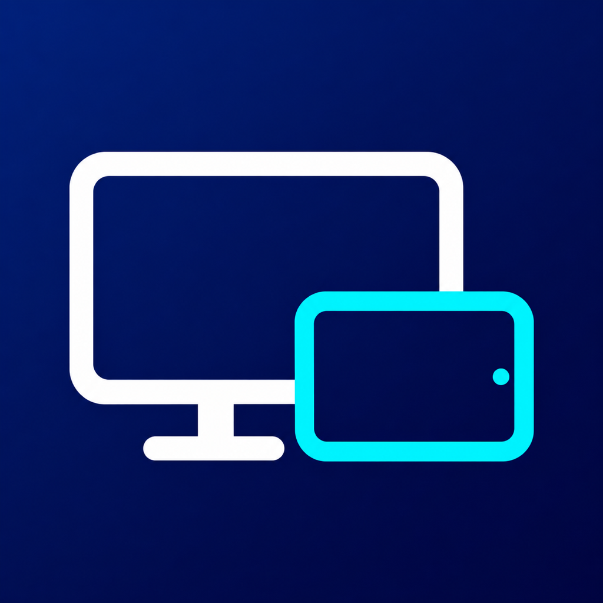
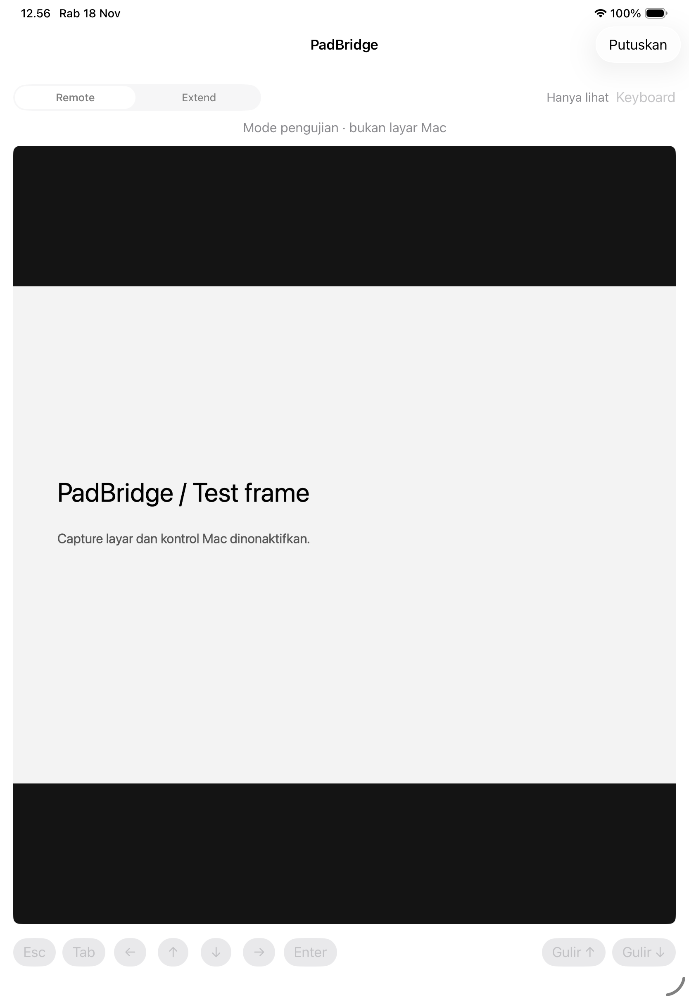

# DeskShift



Tampilkan dan kontrol Mac dari iPad atau iPhone. Gunakan **Remote** untuk layar utama atau **Extend** untuk desktop tambahan. Setelah pemasangan pertama, DeskShift menyimpan sambungan sehingga kamu bisa memilih nama Mac untuk terhubung lagi.

- **Satu jaringan** — aplikasi menyambung langsung setelah kamu memasukkan kode.
- **Wi-Fi berbeda, hotspot, atau data seluler** — siapkan relay pribadi sekali, lalu pasangkan perangkat dengan kode baru. Kode yang sama mendukung sambungan lokal dan internet.



*Tampilan iPad dalam mode pengujian sebelum perubahan nama dari PadBridge ke DeskShift.*

## Yang diperlukan

| Perangkat | Kebutuhan |
| --- | --- |
| Mac yang akan dikontrol | macOS 14 atau lebih baru. Untuk build Mac, gunakan Swift 5.10 atau lebih baru. |
| Mac untuk memasang aplikasi seluler | Xcode 16.2 atau lebih baru yang mendukung versi OS perangkat, Akun Apple, dan kabel USB untuk pemasangan pertama. |
| iPad atau iPhone | iPadOS 17 atau iOS 17 ke atas. |
| Akses lewat internet | Akun Cloudflare dan Node.js dengan npm untuk relay `workers.dev`, atau server publik sendiri untuk relay Python. |

Repo ini menyediakan kode sumber untuk dibangun sendiri. Pemasangan iPad dan iPhone dilakukan lewat Xcode. [Kompatibilitas Xcode dan sistem operasi](https://developer.apple.com/xcode/system-requirements/).

Unduh sumber lewat **Code → Download ZIP**, atau klon repo dan buka Terminal di folder proyek.

```sh
git clone https://github.com/anandaraflialfarizi/DeskShift.git
cd DeskShift
```

## Pasang di iPad atau iPhone

1. Di Xcode, masuk dengan Akun Apple lewat **Xcode → Settings → Accounts**.
2. Buka `iPad/PadBridgeiPad.xcodeproj`. Pilih target dan skema **PadBridgeiPad**. Target yang sama mendukung iPad dan iPhone.
3. Di **Signing & Capabilities**, aktifkan **Automatically manage signing**, pilih **Team** milikmu, dan gunakan **Bundle Identifier** yang unik. Jika perlu membuat sertifikat, buka **Settings → Accounts → Manage Certificates** dan tambahkan **Apple Development**.
4. Sambungkan perangkat ke Mac, buka kuncinya, dan ketuk **Trust** jika diminta. Aktifkan **Developer Mode** lewat **Settings → Privacy & Security** pada perangkat jika Xcode memintanya.
5. Pilih iPad atau iPhone sebagai tujuan di toolbar Xcode dan tekan **Run** (⌘R). Ikuti konfirmasi iOS/iPadOS yang muncul. Ikon **DeskShift** akan muncul setelah instalasi berhasil. Kalau muncul **Untrusted Developer**, buka **Settings → General → VPN & Device Management** dan percayai profil Apple Development milikmu.

Akun Apple gratis bisa digunakan melalui **Personal Team**. Profilnya berlaku tujuh hari. Untuk memperbaruinya, jalankan **Run** lagi dari Xcode. [Pemasangan ke perangkat](https://developer.apple.com/documentation/Xcode/running-your-app-on-simulated-or-physical-devices) · [Developer Mode](https://developer.apple.com/documentation/xcode/enabling-developer-mode-on-a-device) · [Personal Team](https://developer.apple.com/help/account/basics/about-your-developer-account/).

## Pasang host di Mac

Dari folder proyek, build dengan sertifikat Apple Development yang dibuat di Xcode.

```sh
./scripts/build-app.sh
mkdir -p "$HOME/Applications"
ditto dist/PadBridge.app "$HOME/Applications/PadBridge.app"
open "$HOME/Applications/PadBridge.app" --args --setup
```

Jika skrip menemukan beberapa sertifikat, lihat daftarnya dengan `security find-identity -v -p codesigning` dan isi `PADBRIDGE_SIGNING_IDENTITY` dengan ID sertifikat pilihan ketika menjalankan skrip. Untuk uji lokal di Mac sendiri, `PADBRIDGE_SIGNING_IDENTITY=- ./scripts/build-app.sh` membuat build ad hoc. Build ad hoc baru dapat memerlukan izin macOS lagi.

1. Buka **DeskShift** di menu bar. Beri izin **Screen & System Audio Recording** untuk tampilan dan **Accessibility** untuk klik, gulir, dan keyboard. Buka ulang DeskShift bila macOS memintanya. Izinkan **Local Network** bila diminta.
2. Centang **Jalankan saat login** jika ingin host siap setelah masuk ke macOS.
3. Saat kedua perangkat satu jaringan, pilih **Kode sambungan… → Salin kode** di Mac, lalu tempel di DeskShift di iPad atau iPhone dan ketuk **Hubungkan ke Mac**. Izinkan **Local Network** bila diminta. Setelah tersambung, aplikasi menyimpan profil Mac di Keychain.

Kamu juga bisa mengirim kode lewat **Kode sambungan… → Lewat Akun Apple…** menggunakan Handoff saat perangkat berdekatan, memakai Akun Apple yang sama dan mengaktifkan Wi‑Fi, Bluetooth, dan Handoff. Sambungan dari jauh masih memerlukan relay. [Cara menggunakan Handoff](https://support.apple.com/en-us/102426).

## Akses jarak jauh dengan Wi-Fi berbeda

Relay meneruskan koneksi antara Mac dan iPad/iPhone. Keduanya membuat koneksi keluar ke relay, sehingga router tempat Mac berada tidak perlu diatur untuk port forwarding. Setiap pengguna menyiapkan relay untuk Mac sendiri.

### Cloudflare Workers tanpa VPS atau domain sendiri

1. Selesaikan pemasangan host Mac dan buka DeskShift sekali agar profil Mac dibuat. Aktifkan subdomain `workers.dev` di akun Cloudflare jika belum ada. Gunakan Node.js dan npm yang kompatibel dengan Wrangler. [Instal Wrangler](https://developers.cloudflare.com/workers/wrangler/install-and-update/) · [Aktifkan workers.dev](https://developers.cloudflare.com/workers/configuration/routing/workers-dev/).
2. Deploy Worker dari folder proyek. Ubah `name` di `relay/cloudflare/wrangler.jsonc` terlebih dahulu jika nama tersebut sudah dipakai Worker lain di akunmu.

   ```sh
   cd relay/cloudflare
   npx wrangler login
   npx wrangler deploy
   npx wrangler secret put PADBRIDGE_ROOM
   ```

   Saat Wrangler meminta nilai `PADBRIDGE_ROOM`, jalankan perintah di bawah di Terminal lain dan tempel hasilnya pada prompt Wrangler. Perintah ini menampilkan ID ruang Mac.

   ```sh
   "$HOME/Applications/PadBridge.app/Contents/MacOS/PadBridge" --managed-room
   ```

3. Kembali ke folder utama proyek. Gunakan konfigurasi host baru untuk jalur ini. Jika host memakai relay Python, alamat yang tersimpan di Mac akan diprioritaskan. Tutup host lewat **Keluar DeskShift**, ganti alamat contoh di bawah dengan URL yang ditampilkan Wrangler menggunakan awalan `wss://`, lalu build ulang dengan identitas signing yang sama.

   ```sh
   cd ../..
   PADBRIDGE_DEFAULT_RELAY=wss://padbridge-personal-relay.example.workers.dev ./scripts/build-app.sh
   ditto dist/PadBridge.app "$HOME/Applications/PadBridge.app"
   open "$HOME/Applications/PadBridge.app"
   ```

4. Pilih **Kode sambungan… → Salin kode** lagi di Mac. Jika iPad/iPhone sudah menyimpan profil lama, ketuk **Lupakan Mac ini**, lalu tempel kode baru dan sambungkan. Kode baru membawa alamat relay. Pada Mac, menu menampilkan **Internet: menunggu perangkat** saat host siap menerima sambungan relay. Aplikasi mencoba jalur lokal dulu, lalu beralih ke relay jika Mac tidak bisa dijangkau secara lokal.
5. Biarkan Mac menyala, tetap login, tersambung ke internet, dan DeskShift berjalan. Pindahkan iPad/iPhone ke Wi-Fi berbeda, hotspot, atau data seluler, lalu hubungkan lewat profil tersimpan. Uji langkah ini sebelum meninggalkan Mac.

Konfigurasi Cloudflare ini melayani satu Mac dan satu perangkat yang terhubung melalui relay dalam satu waktu. Jika kamu memilih **Ganti kode dan putuskan sesi** di Mac, jalankan lagi `--managed-room` dan perbarui secret `PADBRIDGE_ROOM` sebelum memasangkan kode baru. [Secret Cloudflare Workers](https://developers.cloudflare.com/workers/configuration/secrets/).

### Relay Python di server sendiri

1. Siapkan server yang dapat dijangkau dari internet dengan Python 3.9+, hostname, dan sertifikat TLS tepercaya untuk hostname tersebut. Buka TCP 9443 pada **server relay**.
2. Salin `relay/padbridge_relay.py` ke server. Buat kunci host 64 karakter heksadesimal dengan `python3 -c 'import secrets; print(secrets.token_hex(32))'` dan simpan sebagai environment variable `PADBRIDGE_HOST_KEY` untuk proses server. Jaga agar kunci hanya bisa dibaca oleh administrator dan proses relay.

   ```sh
   python3 padbridge_relay.py --listen 0.0.0.0 --port 9443 \
     --cert /path/to/fullchain.pem --key /path/to/private-key.pem
   ```

3. Di menu DeskShift pada Mac, buka **Sambungkan server sendiri…**, masukkan `tls://relay.example.com:9443` dengan hostname milikmu serta kunci host tadi, lalu tekan **Sambungkan**.
4. Salin kode baru dan pasangkan lagi seperti langkah Cloudflare di atas. Untuk pemakaian tetap, jalankan relay sebagai service dan perbarui sertifikat sebelum kedaluwarsa.

## Kontrol dan batas penggunaan

- Ketuk untuk klik, geser satu jari untuk drag, dan pakai dua jari untuk menggulir. **Keyboard** menerima masukan dari keyboard layar, Magic Keyboard, atau keyboard fisik lain yang terhubung. **Layar penuh** memperbesar tampilan.
- **Remote** menampilkan layar utama. **Extend** membuat layar virtual 1600 × 1200. Mode Extend memakai API privat macOS yang ketersediaannya dapat berubah.
- Koneksi internet memakai enkripsi antarperangkat untuk layar dan input. Kode sambungan memberi akses ke Mac milikmu, jadi simpan secara pribadi. **Ganti kode dan putuskan sesi** mencabut kode lama.
- Mac harus aktif untuk remote. Sebelum pergi, sambungkan charger dan biarkan tutup MacBook terbuka. Mode tidur, reboot sebelum login, dan FileVault sebelum login bisa membuat host tidak terjangkau.
- Jika layar kosong, periksa izin **Screen & System Audio Recording** di Mac. Jika layar tampil tetapi input gagal, periksa izin **Accessibility**. Jika sambungan hanya jalan di Wi-Fi yang sama, cek relay aktif dan pasangkan ulang menggunakan kode yang memuat alamat relay.

## Pemeriksaan pengembangan

```sh
swift test
python3 -m unittest discover -s relay -v
./scripts/build-ipad.sh
```

`build-ipad.sh` hanya membangun aplikasi untuk simulator Apple silicon. Untuk mencoba layar dan input di perangkat fisik, gunakan langkah Xcode di atas. Saat host biasa sudah ditutup, tes UI dapat dijalankan dengan `.build/debug/PadBridge --test-server --test-keyboard` dan target `PadBridgeUITests` di simulator. Mode tersebut mengirim frame tes dan menerima input tes yang tidak diarahkan ke Mac.
